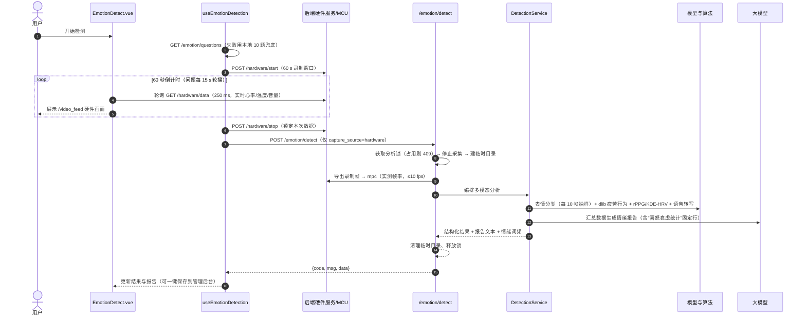

# CUG 多模态健康与情绪智能检测系统

> Personal Health & Emotion Intelligence System

基于 **计算机视觉、语音信号处理、非接触式生理测量（rPPG）、中医舌象辨识与大语言模型** 的多模态身心健康智能分析平台。
自带 ESP32-S3 多传感器硬件端，浏览器只做展示与控制，**所有采集、推理与报告生成均在后端完成**。

- 前端：Vue 3 + Vite + Pinia（检测体验免登录，报告管理需登录）
- 后端：FastAPI + 6 套本地深度学习模型 + OpenAI 兼容大模型（默认本地 llama-server）
- 硬件：ESP32-S3 + 摄像头 + I2S 麦克风 + MLX90614 红外测温 + LD6002 毫米波雷达心率，串口 / WiFi 双通道

> 职责划分与依赖方向的开发约定见 [docs/architecture.md](docs/architecture.md)；硬件协议细节见 [docs/hardware-protocol.md](docs/hardware-protocol.md)。

---

## 目录

- [1. 功能总览](#1-功能总览)
- [2. 系统架构](#2-系统架构)
- [3. 目录结构详解](#3-目录结构详解)
- [4. 硬件子系统（ESP32-S3）](#4-硬件子系统esp32-s3)
- [5. 后端详解（Emotion-Detect-py）](#5-后端详解emotion-detect-py)
- [6. 前端详解（app）](#6-前端详解app)
- [7. 快速开始](#7-快速开始)
- [8. 配置参考](#8-配置参考)
- [9. 测试](#9-测试)
- [10. 运维与脚本](#10-运维与脚本)
- [11. 边界与已知限制](#11-边界与已知限制)
- [12. 故障排查 FAQ](#12-故障排查-faq)

---

## 1. 功能总览

所有检测只使用后端硬件采集：前端展示硬件视频流并控制采集，**不访问浏览器摄像头或麦克风**；语音识别由后端模型处理。

| 模块 | 功能说明 | 技术实现 |
| :--- | :--- | :--- |
| **健康问诊** | 舌象四维识别（舌色/苔色/裂纹/齿痕）、中医体质判定、一分钟问诊语音转写、心率血压估算、AI 综合问诊报告 | 4×EfficientNet-B0 + 规则引擎（GB/T 46939—2025）+ FunASR + KDE-HRV/rPPG + 大模型 |
| **疲劳检测** | 眨眼频率、哈欠次数、点头次数、闭眼时长占比（PERCLOS）、说话占比、HRV 疲劳概率、分级干预建议 | dlib 68 点特征 + EAR/MAR/头部姿态规则 + KDE-HRV |
| **情绪识别** | 面部 7 类基础表情统计、语音转写与内容分析、心率/体温生理监测、AI 心理健康分析报告（含"喜怒哀虑"词频统计） | 轻量人脸检测 RFB + MobileNetV2 表情分类 + SenseVoiceSmall + 多模态融合大模型 |
| **情感数字人** | AI 陪伴对话交互界面；表演段（idle/greet/talk + 过渡）由 `digital-human/` 出片流水线产出（SCAIL-2 动作迁移 + LTX-2.3 首尾帧，704×1280@20fps） | 预留大模型对话接入 + digital-human 段库 |
| **健康管理后台** | 注册登录、历次检测报告结构化归档、报告检索、历史多维综合分析、头像上传 | SQLite(WAL) + JWT 认证 + PBKDF2 + 数据可视化 |

### 一分钟检测的标准流程（三个检测模块一致）

```text
① 硬件采集（默认 60 s）        ② 多模态分析（后端）                ③ 结果展示
POST /hardware/start    →    视频导出 mp4（实测帧率）        →    表情占比环形图
MJPEG 实时预览                dlib 疲劳行为分析                    行为指标卡片
实时心率/温度/音量轮询         rPPG + KDE-HRV 心率                 心率趋势 / 音频波形
问题定时轮播（语音回答）       FunASR 语音转写                      转写文本
POST /hardware/stop    →     大模型综合报告                  →    AI 报告（可保存入库）
```

---

## 2. 系统架构

### 2.1 组件与端口

```text
┌─────────────────────────────── 浏览器 ───────────────────────────────┐
│  Vue 3 SPA (http://localhost:5173)                                   │
│  检测页 / 管理后台 / 硬件模式切换         标签直接拉 MJPEG 预览   │
└──────────────┬───────────────────────────────────────────────────────┘
               │ /python-api/*（Vite 开发代理，改写前缀后转发）
               ▼
┌─────────────────────────────── 后端 ────────────────────────────────┐
│  FastAPI (0.0.0.0:8081)                                             │
│  ├─ routers/    检测业务 API（情绪/健康/疲劳/舌象/硬件）              │
│  ├─ management/ 账号、报告、分析 API（JWT + SQLite）                  │
│  ├─ services/   检测编排、媒体导出、语音转写、舌象、AI 报告           │
│  ├─ mcu/        设备会话：协议解析 / 串口与 WiFi 传输 / 录制窗口      │
│  └─ 模型：表情 MobileNetV2 · FunASR SenseVoiceSmall · 舌象 4×EffNet │
│          dlib 疲劳 · mediapipe+rPPG 心率 · OpenAI 兼容 LLM 客户端    │
└──────┬───────────────────────────────────┬──────────────────────────┘
       │ OpenAI /chat/completions          │ 串口(USB CDC 2 Mbaud)
       ▼                                   │ 或 WiFi（TCP 8888 + UDP 8889）
┌──────────────────┐                    ┌──────────────────────────────┐
│ llama-server     │                    │ ESP32-S3（esp32s3/mix.ino）  │
│ :1919            │                    │ OV2640 摄像头 (VGA JPEG)     │
│ Ternary-Bonsai-  │                    │ INMP441 麦克风 (48 kHz I2S)  │
│ 2-27B（本地 GGUF)│                    │ MLX90614 红外测温            │
│ 或 SiliconFlow   │                    │ LD6002 雷达心率              │
└──────────────────┘                    └──────────────────────────────┘
```

| 端口 / 地址 | 用途 |
| :--- | :--- |
| `5173` | Vite 前端开发服务器（`npm run dev`） |
| `8081` | FastAPI 后端（Swagger 文档：`http://localhost:8081/docs`） |
| `1919` | 本地 llama-server（OpenAI 兼容 `/v1`） |
| `8888/TCP` | ESP32 → 后端：温度 / 雷达 / JPEG 图像流（COBS + `0x00` 分帧） |
| `8889/UDP` | ESP32 → 后端：48 kHz 音频包（原始包，无 COBS） |
| `COMx @ 2000000` | 串口模式（ESP32-S3 USB CDC） |
| 设备默认 IP `192.168.8.11` | WiFi 模式下 ESP32 的 TCP 服务地址 |

### 2.2 技术栈

| 层 | 技术 |
| :--- | :--- |
| 前端 | Vue `^3.5.26`、Vite `^7.3.0`、Pinia `^3.0.4`、Vue Router `^4.6.4`、Axios `^1.13.2`；Node `^20.19.0 \|\| >=22.12.0`；测试用 Node 内置 `node --test`，格式化用 Prettier |
| 后端 | Python 3.10 ~ 3.12、FastAPI `>=0.115`、Uvicorn、Pydantic `>=2`、python-dotenv |
| 视觉/数值 | OpenCV `>=4.8`、NumPy、SciPy、dlib `>=19.24`（68 点关键点）、MediaPipe `>=0.10`（FaceMesh） |
| 深度学习 | PyTorch `>=2.0` + torchvision、ONNX Runtime、FunASR `>=1.0`（语音）、basetrainer/pybaseutils（表情子工程训练框架） |
| 音频 | PyAudio（可选本地回放）、ffmpeg（48 kHz→16 kHz 重采样，需在 PATH 中） |
| 硬件 | PySerial、cobs（COBS 编解码） |
| 大模型 | `openai` SDK 连接任意 OpenAI 兼容服务；默认本地 llama-server 运行 `Ternary-Bonsai-2-27B-PQ2_0`，可切换 SiliconFlow 云端模型 |
| 存储 | SQLite（WAL 模式，外键开启）；`data/emotion_management.db` |
| 硬件固件 | Arduino IDE + ESP32 Arduino Core 3.3.x（ESP32-S3，OPI PSRAM，USB CDC On Boot） |

### 2.3 一次情绪检测的完整调用链（前后端时序）



---

## 3. 目录结构详解

```text
emotionDetect/
├── README.md                       # 本文件
├── docs/
│   ├── architecture.md             # 代码结构与解耦说明（分层依赖、扩展与测试约定）
│   └── hardware-protocol.md        # ESP32-S3 硬件接入协议说明
├── start_local_llm.ps1             # 启动本地大模型（llama-server :1919）
├── stop_backend.ps1 / .bat         # 一键停止后端（8081）；-All 同时停大模型（1919）
├── .gitignore                      # 忽略缓存/权重/多媒体/数据库；保留 68 点关键点权重
│
├── app/                            # ================= 前端工程（Vue 3 + Vite） =================
│   ├── package.json                #   脚本：dev / build / preview / test / format
│   ├── vite.config.js              #   @ 别名、手动分包（vue-vendor、axios）、/python-api 代理
│   ├── config/backendProxy.js      #   代理连不上 8081 时返回 503 JSON 提示
│   ├── index.html
│   ├── tests/                      #   Node 内置测试：backendProxy / detection 契约
│   └── src/
│       ├── main.js / App.vue       #   入口：挂载 Pinia + Router
│       ├── router/index.js         #   路由表 + 登录守卫（requiresAuth / guestOnly）
│       ├── stores/user.js          #   Pinia 用户状态（token/user 持久化到 localStorage）
│       ├── api/                    #   领域 API 层
│       │   ├── http.js             #     统一 HTTP 工厂：API_BASE、code==0/200 解包、错误提取
│       │   ├── request.js          #     管理端实例：自动带 JWT、toast、401 跳登录
│       │   ├── detectionPayload.js #     检测请求序列化（FormData + capture_source=hardware）
│       │   ├── emotion.js / health.js / fatigue.js / hardware.js   # 检测领域
│       │   └── auth.js / user.js / report.js                       # 管理领域
│       ├── composables/            #   可复用能力
│       │   ├── useDetectionTask.js     # 防重入、AbortController 取消、阶段状态机、进度
│       │   ├── useHardwareCapture.js   # 拥有本页采集：启动/停止、迟到启动补发停止
│       │   ├── useHardwareMonitor.js   # 页面存活期 250 ms 轮询实时数据（心率历史）
│       │   ├── useQuestionnaire.js     # 问题定时轮播
│       │   ├── useCountdown.js         # 统一倒计时（60 s）
│       │   ├── useDetectionGuard.js    # 离开页面保护
│       │   └── useAnalysisProgress.js  # 分析阶段假进度条
│       ├── features/detection/     #   检测业务编排
│       │   ├── useEmotionDetection.js    # 情绪：取问题→采集→停止→分析→展示
│       │   ├── useEmotionPresentation.js # 结果映射：表情占比、喜怒哀虑图标、指标卡
│       │   ├── useHealthDetection.js     # 健康：舌象抓拍→生成问题→问诊→分析
│       │   ├── useFatigueDetection.js    # 疲劳：采集→停止→一键分析
│       │   └── useHardwareSettings.js    # 串口/WiFi 连接设置（localStorage 记忆）
│       ├── utils/
│       │   ├── detectionMetrics.js     # 纯函数：指标格式化、心率/波形 SVG 折线点
│       │   └── toast.js                # 零依赖全局 toast（替代 Element Plus）
│       ├── components/             #   DetectionShell / DetectionNav / DetectionProcess /
│       │                           #   AuthShell / HardwareModeSwitch（模式切换大组件）
│       ├── styles/detection/       #   三个检测页 scoped 样式（emotion/health/fatigue.css）
│       ├── assets/                 #   模块切图与指标图标
│       └── views/
│           ├── HomeView.vue            # 首页：四模块雷达导航 + 硬件模式开关
│           ├── detect/
│           │   ├── EmotionDetect.vue   # 情绪识别页（333 行）
│           │   ├── HealthDetect.vue    # 健康问诊页（313 行）
│           │   ├── FatigueDetect.vue   # 疲劳检测页（200 行）
│           │   └── CompanionDetect.vue # 情感数字人页（662 行，数字人驱动待接入）
│           ├── account/                # LoginView / RegisterView
│           └── management/             # ManagementLayout / Dashboard / Profile / Password /
│                                       # ReportList / ReportDetail / Analysis
│
└── Emotion-Detect-py/              # ================= 后端与算法服务（FastAPI） =================
    ├── app_api.py                  # 入口：python app_api.py / uvicorn app_api:app
    │                               #   启动前自动清理占用 8081 的残留进程（netstat+taskkill）
    ├── application.py              # create_app() 工厂：CORS、路由挂载、/uploads 静态资源
    ├── requirements.txt            # Python 依赖清单
    ├── .env.example                # 环境变量样例（复制为 .env 使用）
    ├── core/                       # 核心基础设施
    │   ├── config.py               #   路径、AI_CONFIG、串口/WiFi/音频配置（.env 加载）
    │   ├── hardware_profile.py     #   固件线协议常量（波特率、端口、包长、帧率上限）
    │   ├── contracts.py            #   HTTP 输入契约（CaptureRequest/TransportRequest/ConsultationInput）
    │   ├── responses.py            #   统一成功响应 {"code":0,"msg","data"}
    │   ├── state.py                #   全局模型容器 + 4 把互斥锁（情绪/健康/疲劳/舌象）
    │   ├── lifecycle.py            #   lifespan：独立加载 3 组模型 → 初始化 DB → 启动设备监听
    │   └── logger.py               #   统一 logging（emotion.* 命名空间，stdout）
    ├── routers/                    # 业务 HTTP 适配层（详见 §5.3）
    │   ├── emotion.py  health.py  fatigue.py  tongue.py  hardware.py
    │   └── dependencies.py         #   输入边界：表单含 audio/video 直接 400
    ├── services/                   # 应用服务层
    │   ├── dependencies.py         #   生产依赖组装（FastAPI Depends 覆盖点）
    │   ├── detection_service.py    #   情绪/健康/疲劳编排 + 心率融合规则
    │   ├── analysis_pipeline.py    #   detection_session：锁→停采集→临时目录→异常映射
    │   ├── hardware_service.py     #   硬件操作、状态汇总、MJPEG 预览（质量 95，10 fps）
    │   ├── media_service.py        #   录制帧→mp4、PCM→WAV（48k 原始 + 16k ASR）
    │   ├── speech_service.py       #   FunASR 转写、文本清洗、按两句合并分段
    │   ├── physiology_service.py   #   疲劳/KDE-HRV 算法适配（缺数据返回 None 结构）
    │   ├── tongue_service.py       #   画质检查→四维分类→体质报告
    │   ├── ai_service.py           #   LLM 调用：情绪报告/健康报告/问诊问题/疲劳建议
    │   └── video_service.py        #   旧导入路径兼容层
    ├── mcu/                        # 设备基础设施层
    │   ├── client.py               #   MCUClient：监听线程、录制窗口、线程安全状态缓存
    │   ├── protocol.py             #   COBS 分帧 + 四类包解析（音频/温度/心率/图像）
    │   ├── transport.py            #   SerialTransport / WiFiTransport（TCP+UDP 双通道）
    │   ├── control.py              #   MODE 命令与固件确认帧契约
    │   └── audio_exporter.py       #   PCM→WAV、ffmpeg 重采样、可选 PyAudio 回放
    ├── management/                 # 管理端（认证/报告/分析）
    │   ├── config.py               #   JWT 密钥、TTL、数据目录（.env）
    │   ├── database.py             #   SQLite WAL 连接管理 + 建表（users/reports）
    │   ├── security.py             #   PBKDF2 密码、手写 HS256 JWT、jti 注销表
    │   ├── schemas.py  dependencies.py  responses.py
    │   └── routers/                #   auth / users / reports / analytics / files
    ├── detection_models/           # 行为疲劳（fatigue_v03.py）+ KDE-HRV（kde_hrv.py）
    │   └── assets/shape_predictor_68_face_landmarks.dat   # dlib 68 点权重（唯一入库权重）
    ├── face_detection/             # 人脸检测（Ultra-RFB）+ 表情分类（MobileNetV2 7 类）
    │   ├── face_detection_logic.py #   Predictor：视频抽帧→检测→分类→emotion_log
    │   ├── classifier/ libs/       #   推理封装与轻量检测器（rfb-face-mask.pth）
    │   └── data/pretrained/.../latest_model_099_94.7200.pth   # 表情权重（94.72%）
    ├── voice_detection/models/iic/ # SenseVoiceSmall（ASR+情感）+ FSMN-VAD 本地模型
    ├── tongue_diagnosis/           # 4×EfficientNet-B0 舌象推理 + 体质规则引擎
    │   ├── efficient_net/predictor.py      # TonguePredictor 统一推理接口
    │   ├── constitution_model.py           # 36 条规则 → 9 种中医体质（GB/T 46939—2025）
    │   └── errors.py                       # 不依赖 PyTorch 的异常契约
    ├── tools/wifi_capture_cli.py   # 独立 WiFi 采集调试 CLI（OpenCV 预览窗口）
    ├── data/                       # 运行时生成：SQLite 数据库、上传文件（不入库）
    └── tests/                      # pytest 回归（详见 §9）
│
└── digital-human/                 # ================= 数字人出片模块（离线工具链） =================
    ├── README.md                  # 流水线/配方/已知坑；接入关系见其中「在 emotionDetect 中的接入关系」
    ├── config.py                  # 路径集中（ComfyUI 目录、704×1280@20fps 规格、ffmpeg）
    ├── pipeline/make_chain.py     # 主流程：SCAIL 迁移→端点帧→LTX 多种子选优→拼接→QA
    ├── graphs/                    # SCAIL-2 / LTX-2.3 首尾帧 ComfyUI 图构建（v28 配方）
    ├── comfy/api.py               # ComfyUI REST 客户端 + 读帧/帧差/抖动指数
    ├── recipes/                   # 提示词与参数配方（JSON）；SCAIL 底快照=用户 UI 验证参数
    ├── tools/                     # QA 拼图（Flash 验收）+ 运动指标分析
    ├── workflows/                 # ComfyUI 原始工作流 JSON 备份（LTX/SCAIL×2）
    ├── assets/                    # 参考图 + 姿态视频（复跑 v28 必需，mp4 已开 gitignore 例外）
    └── runs/                      # 每次运行中间产物（不入库）
```

跑法：`cd digital-human && E:\ZCodeWorkspace\venv\Scripts\python.exe -m pipeline.make_chain`

---

## 4. 硬件子系统（ESP32-S3）

固件位于 `esp32s3/mix/`：`mix.ino` 负责传感器初始化与采集，`TransportRuntime.h` 负责通道选择、命令解析、发送队列与非阻塞输出。

### 4.1 传感器与引脚

| 外设 | 型号 / 接口 | 关键配置 |
| :--- | :--- | :--- |
| 摄像头 | OV2640（DVP，XCLK 20 MHz） | VGA (640×480) JPEG，`jpeg_quality=10`（数值越小画质越高），帧间隔 100 ms ≈ 10 fps，`CAMERA_GRAB_LATEST` + PSRAM 双缓冲；引脚 D0–D7 = 47/21/14/13/12/11/10/9，VSYNC=15，HREF=16，PCLK=17，SCCB=2/1 |
| 麦克风 | INMP441（I2S_NUM_0） | 48 kHz、32-bit 采集后右移 16 位转 int16、仅左声道；引脚 SCK=40，WS=42，SD=41；独立 FreeRTOS 任务（绑核 1），每凑满 256 采样发一包 |
| 红外测温 | Adafruit MLX90614（I2C，引脚 2/1） | 环境温度 + 物体温度双 float32，每 500 ms 一包 |
| 雷达心率 | LD6002（Serial1 @115200，RX=44，TX=43） | 非接触 BPM，每 500 ms 重发缓存值（30–230 bpm 之外后端丢弃）；**无逐搏 RR 间隔，硬件 HRV 不可用** |
| 任务布局 | FreeRTOS | 音频采集绑核 1；串口/WiFi 发送任务绑核 0；USB 与 WiFi 各自独立发送队列 |

### 4.2 数据包格式（全小端）

串口所有数据、TCP 中温度/雷达/JPEG 均为 **COBS 编码后追加 `0x00` 分隔符**；UDP 音频直接发送原始包（无 COBS、无分隔符）。

| 数据 | 包结构 | 长度 | 通道 | 到达频率 |
| :--- | :--- | :--- | :--- | :--- |
| 音频 | `0x01` + 256×int16 PCM | 513 B | 串口 / UDP | 48 kHz ÷ 256 ≈ 187.5 包/秒 |
| 温度 | `0x02` + float32 环境温 + float32 物体温 | 9 B | 串口 / TCP | 2 Hz |
| 雷达心率 | `0x04` + float32 BPM | 5 B | 串口 / TCP | 2 Hz |
| 图像 | 完整 JPEG（`FF D8 … FF D9`，无类型头） | 可变 | 串口 / TCP | ≤10 fps（图像队列只保留最新一帧） |

后端解析侧（`mcu/protocol.py`）：

- 值域校验：环境温 −30~100 ℃、物体温 −10~120 ℃、心率 30–230 bpm，越界直接丢弃。
- 音频包实时计算 RMS 音量（0–100）与 32 点有符号波形（供前端画波形）。
- JPEG 帧在后端统一做 **逆时针旋转 90° + 水平镜像**（安装方向校正，非格式要求）。
- 兼容旧固件 COBS 编码器"省略尾零空块"的缺陷：仅当已知定长包恰好少 1 字节时补零；超长半帧丢弃至下一个分隔符。
- 模式确认帧：`COBS{0x10, 0x01, 0x01|0x02} + 00`（serial=1 / wifi=2），后端 3 秒内未收到确认则状态置 `unconfirmed`。

### 4.3 传输模式与切换

- 上电默认 Serial 输出（不写入闪存）；WiFi 常驻联网并监听 TCP 8888，**USB 始终可接收命令**。
- 后端每次建立连接（含重连）立即发送 `MODE WIFI\n` 或 `MODE SERIAL\n`，因此双向切换都不要求旧通道仍连通。
- WiFi 模式下后端先绑定 UDP 8889 再连接设备 TCP 8888；固件取 TCP 客户端 IP 作为 UDP 音频目标，只接受该 IP、513 字节的音频包（防串扰）。
- 固件只允许一个 TCP 客户端；独立调试脚本（`tools/wifi_capture_cli.py`）与后端不可同时连接。
- 切换传输会结束录制并清空实时缓存；已录制会话保留供分析。
- `GET /hardware/mode` 返回 `output_mode_status`：`pending / confirmed / unconfirmed`，前端据此提示"等待设备确认"。

### 4.4 固件发送队列与非阻塞策略（TransportRuntime.h）

| 队列 | 深度 | 溢出策略 |
| :--- | :--- | :--- |
| serialPackets（传感器+音频） | 32 | 丢最新入队包 |
| serialImages / tcpImages | 1 | 只保留最新一帧 |
| tcpPackets | 8 | 丢最新入队包 |
| udpPackets | 16 | 丢最旧音频包 |

TCP 每轮最多发 1460 字节（非阻塞 socket），同轮先处理控制命令和 UDP 音频，避免大图拖垮其他数据；输出阻塞 500 ms 自动复位，从分隔符恢复。**短时拥塞可能丢帧/丢音频，协议无校验和、无序号，后端无法检测或补回丢失采样。**

### 4.5 固件烧录

1. 用 Arduino IDE 打开整个 `esp32s3/mix` 目录中的 `mix.ino`（确保同目录 `TransportRuntime.h` 参与编译）。
2. 参考编译配置：ESP32 Arduino Core 3.3.x、板型 ESP32-S3、USB CDC On Boot Enabled、OPI PSRAM；Flash/PSRAM 与 USB 模式沿用板卡原有有效配置。
3. 关闭占用 USB 串口的串口监视器与后端进程后再烧录；烧录后启动后端，在网页"硬件模式"中选择目标模式并等待"设备已确认"。
4. WiFi SSID/密码硬编码在 `mix.ino` 顶部（当前 `HUAWEI_7FF0`），换网络需改源码重新烧录；自定义 TCP/UDP 端口同样需要固件同步修改（前端改端口只改后端配置）。

---

## 5. 后端详解（Emotion-Detect-py）

### 5.1 分层与依赖方向

```text
routers（HTTP 适配：参数、状态码、响应封装）
   │  依赖注入 services/dependencies.py
   ▼
services（业务编排：检测会话、媒体、语音、生理、舌象、AI）
   │  只面向"设备能力接口"与注入的算法函数
   ▼
mcu/*（协议、传输、设备会话） + detection_models / face_detection / tongue_diagnosis / voice_detection（算法）
   │
   ▼
core/*（配置、状态、日志、契约） + management/*（SQLite、JWT）
```

关键约定（详见 `docs/architecture.md`）：

- 路由不加载模型、不拼接报告；业务异常不直接抛 `HTTPException`（`ModelUnavailableError` 由会话层统一映射 503）。
- `DetectionService` 为纯 dataclass，依赖全部由 `services/dependencies.py` 注入，测试可整体替换。
- `application.create_app(lifespan=...)` 支持测试替换 lifespan，导入应用不会触发模型加载。
- 各模型加载互相隔离（独立 try/except），一个模型失败不影响其他模型与设备启动。

### 5.2 启动入口与生命周期

- `python app_api.py`：先 `free_port_if_occupied(8081)`（Windows `netstat` 找到残留监听进程并 `taskkill /F /T`），再以 `uvicorn` 启动 `0.0.0.0:8081`，`timeout_graceful_shutdown=2`（1~2 秒内断开流媒体与硬件线程）。
- `lifespan` 顺序：表情模型 → FunASR 语音模型（本地 SenseVoiceSmall + FSMN-VAD，`cuda:0`，ONNX）→ 舌象四维模型 → `init_database()` → `mcu_client.start()`（后台监听线程）；关闭时 `mcu_client.stop()`。
- CORS 全开（`allow_origins=["*"]`）；`/uploads` 挂载静态目录供头像访问。
- Swagger：`http://localhost:8081/docs`；应用标题 "CUG 多模态健康与情绪智能检测 API"，版本 2.0.0。

### 5.3 API 全量参考

#### 5.3.1 检测业务 API（`routers/`，响应统一 `{"code":0,"msg","data"}`）

| 方法 | 路径 | 别名 | 说明 |
| :--- | :--- | :--- | :--- |
| POST | `/hardware/start` | `/serial/start` | 开启录制窗口。Query：`record_duration`（1–600 s，默认 60）、`capture_video`（默认 true）；Body 可传 `CaptureRequest` 覆盖同名字段 |
| POST | `/hardware/stop` | `/serial/stop` | 停止录制并锁定数据；返回帧数/音频块数/心率点数/温度点数统计 |
| GET | `/hardware/data` | `/serial/data` | 设备总状态：连接/录制、传输层信息、心率、温度、音频、视频汇总（前端 250 ms 轮询） |
| GET | `/hardware/mode` | `/serial/mode` | 传输层信息 + `output_mode_status`（pending/confirmed/unconfirmed） |
| POST | `/hardware/mode` | `/serial/mode` | Body `{"mode":"wifi"\|"serial", host?, tcp_port?, udp_port?, port?, baudrate?}`；其他 mode 返回 400 |
| GET | `/video_feed` | — | MJPEG 实时预览（`multipart/x-mixed-replace`，JPEG 质量 95，10 fps 上限；无画面时返回占位帧 "WAITING FOR CAMERA FRAME" / "WAITING FOR MCU"） |
| POST | `/emotion/detect` | `/report/detect` | 情绪检测。Form 仅允许 `capture_source=hardware`；返回表情统计、行为生理、心率、体温、语音转写、AI 报告、喜怒哀虑词频 |
| GET | `/emotion/questions` | `/report/questions` | LLM 生成 10 个心理咨询参考问题（LLM 失败回退本地 10 题） |
| POST | `/health/tongue/capture` | — | 从硬件摄像头当前帧抓拍舌象并四维分析 + 体质判定（无画面 409；画质/推理问题 422；模型未加载 503） |
| POST | `/health/questions` | — | Body `{"tongue": {...}}`；按舌象生成 5 个循序渐进问诊问题（LLM 失败回退本地模板） |
| POST | `/health/detect` | — | Form：`tongue_result` / `questions` / `answers`（JSON 字符串）+ `capture_source=hardware`；语法或容器类型错误 400 |
| POST | `/fatigue/detect` | — | 疲劳检测；无已录视频 409。返回行为生理、心率与干预建议 |

所有检测接口的输入约束（`routers/dependencies.py` + `core/contracts.py`）：

- `capture_source` 只接受 `hardware`（缺省也按 hardware 处理）；传 `browser`/`auto` → 422；表单出现 `audio`/`video` 字段 → 400。
- 检测请求**不携带任何音视频文件**，数据一律来自后端设备录制窗口。
- 无效端口/录制时长由 Pydantic 约束返回 422。

#### 5.3.2 管理端 API（`management/`，响应统一 `{"code":0,"message","data"}`，除注明外需 `Authorization: Bearer <token>`）

| 方法 | 路径 | 说明 |
| :--- | :--- | :--- |
| POST | `/user/register` | 用户名 3–16 位、密码 5–64 位、两次密码一致；重名 409 |
| POST | `/user/login` | 成功返回 `{token, user}`；单用户名 60 秒内失败 5 次触发 429 限流 |
| POST | `/user/logout` | 将当前 token 的 `jti` 加入注销表 |
| GET | `/user/userInfo` | 当前用户信息 |
| PUT/POST | `/user/update` | 更新资料（用户名/性别/年龄/邮箱/头像）；邮箱格式校验、重名 409 |
| PUT/POST | `/user/updatePwd` | 校验原密码后更新（PBKDF2 重新哈希） |
| GET | `/report` | 报告分页列表：`pageNum`、`pageSize`（1–100）、`type`、`keyword`（标题/摘要 LIKE）、`startDate`、`endDate`；按创建时间倒序 |
| POST | `/report/save` | 保存检测报告：type/title/summary/result(JSON)/rawReport/fileAddress |
| GET | `/report/detail?id=` | 报告详情（含 result_json 解析与 rawReport）；越权/不存在 404 |
| DELETE | `/report/delete?id=` | 删除本人报告 |
| POST | `/report/analysis` | Body `{startDate?, endDate?}`：统计检测构成、汇总近 5 份摘要，自动生成一份 `comprehensive` 类型报告（404 表示区间内无报告） |
| POST | `/upload` | 头像上传：JPG/PNG/WEBP、≤5 MB，存 `data/uploads/avatars/<uid>/uuid.ext`，返回 `/uploads/...` 地址 |

### 5.4 错误码与异常映射（`services/analysis_pipeline.py`）

| 状态码 | 场景 |
| :--- | :--- |
| 400 | 表单携带 audio/video；问诊 JSON 语法或容器类型错误；不支持的传输模式 |
| 404 | 报告不存在 / 分析区间内无报告 |
| 409 | 同类检测正在分析（锁被占，**不会**影响正在进行的采集）；疲劳/舌象无已录视频或画面 |
| 422 | 参数校验失败（record_duration 越界、capture_source 非法、舌象画质不达标等） |
| 429 | 登录失败次数过多（60 s 内 5 次） |
| 500 | 检测分析未预期异常（临时目录保证清理） |
| 503 | 所需模型未就绪（`ModelUnavailableError`）；Vite 代理连不上 8081（前端开发态） |

锁的顺序：**先拿分析锁 → 再停止采集 → 再建临时目录 → 导出视频 → 分析**；正常返回、异常、请求取消均清理会话目录并释放锁，临时目录创建失败也会释放锁。

### 5.5 检测编排（`DetectionService`）

**心率融合规则**（`heart_rate()`）：

1. 有视频 → 先跑视频 rPPG（KDE-HRV），得到 avg_hr/realtime_hr/hr_list/SNR/HRV/血压。
2. 硬件雷达（LD6002）本次会话有心率数据 → 以硬件为准（`signal_quality="mcu_hardware_sensor"`），视频只贡献血压与 SNR；**因固件无逐搏 RR 间隔（`hrv_status=unavailable_no_rr_intervals`），HRV 保留视频结果而不从重复 BPM 构造**。
3. 硬件无数据 → 原样返回视频结果。

**情绪检测** `emotion()`：表情模型逐 10 帧抽帧统计 7 类表情 → `dlib` 行为疲劳分析（同一段视频）→ 硬件录音转写 → 心率融合 → 温度汇总 → LLM 生成报告 → 正则提取"喜怒哀虑统计：喜:X 怒:X 哀:X 虑:X"作为词频。LLM 失败时返回带"最终判定：未知"的兜底文本，接口不 5xx。

**健康问诊** `health()`：舌象结果 + 问诊问题 + 用户回答 + 行为生理 + 心率 + 温度 + 语音转写（整段，不臆造逐题对应）一并交给 LLM 生成健康报告；LLM 失败回退本地模板报告。

**疲劳检测** `fatigue()`：行为分析 + 心率 + 疲劳建议（本地规则，不依赖 LLM）：

| fatigue_probability | 等级 | 建议 |
| :--- | :--- | :--- |
| ≥ 0.75 | 重度疲劳 | 立即停止驾驶或高风险操作 |
| ≥ 0.5 | 中度疲劳 | 暂停工作、闭目休息 15–20 分钟 |
| ≥ 0.25 | 轻度疲劳 | 远眺伸展、调整坐姿 |
| < 0.25 | 状态良好 | 保持规律作息 |

### 5.6 AI 服务（`services/ai_service.py`）

- 通过 `openai` SDK 连接 `AI_CONFIG`（`LOCAL_LLM_*` 优先，其次 `SILICONFLOW_*`，默认 `http://127.0.0.1:1919/v1`）。
- 对本地推理/思考型模型默认附加 `chat_template_kwargs: {enable_thinking: false}` 关闭思维链以加速；服务端不支持时自动降级为普通调用。
- `content` 为空且存在 `reasoning_content` 时容错提取。
- 四个能力：`generate_psychology_questions`（10 题心理问诊）、`generate_health_questions`（结合舌象 5 题）、`generate_emotion_analysis_report`（情绪报告 + 固定格式词频行）、`generate_health_analysis_report`（综合健康报告）；均有本地兜底，LLM 不可用不阻塞接口。
- temperature / max_tokens：情绪报告 0.7/1800、健康问题 0.5/700、健康报告 0.5/1800、心理问题 0.7/800。

### 5.7 MCU 设备层（`mcu/`）

`MCUClient`（全局单例 `mcu_client`）核心机制：

- **后台监听线程**：循环 `read_packets()`（UDP 音频）+ `read()`（TCP/串口字节流）→ COBS 解码 → 分发；连接断开自动重连（200 ms 间隔），重连时丢弃旧半帧并清空实时缓存（保留已录制会话）。
- **模式命令**：连接建立即发送 `MODE WIFI\n`/`MODE SERIAL\n`；确认帧 `0x10 0x01 <mode>` 校验输出通道；3 秒未确认状态置 `unconfirmed`。
- **录制窗口**：`start_recording(duration, capture_video)` 清空并开启缓存；`is_recording` 惰性到期（无需定时器）；`stop_recording()` 仅置位锁定数据，实时预览可继续。
- **线程安全**：一把 `RLock` 保护全部状态；实时缓冲（心率 deque 128、波形 deque 512）与录制缓冲（帧列表、心率/温度列表、音频块列表）分离。
- **传输抽象**：`SerialTransport`（PySerial，非阻塞读）与 `WiFiTransport`（TCP 数据流 + 后台线程收 UDP 音频，队列 500 包，仅接受设备 IP 的 513 字节包）；`switch_transport` 平滑切换，无需重启。

### 5.8 算法模型详解

#### ① 人脸检测 + 表情识别（`face_detection/`）

- 人脸检测：Ultra-Light-RFB（`rfb-face-mask.pth`，输入 320×320，置信度 0.85，IoU 0.2），检测框外扩 1.1 倍裁脸。
- 表情分类：MobileNetV2 1.0×，输入 112×112，7 类 `angry/disgust/fear/happy/neutral/sad/surprise`；权重 `latest_model_099_94.7200.pth`（测试准确率 94.72%）。
- 分析流程：视频每 10 帧（`interval=10`）抽帧 → 检测 → 分类 → 追加 `emotion_log`（时间戳/表情/置信度）；`reset_log()` 防止多请求数据污染。
- 设备：`torch.cuda.is_available()` 自动选 `cuda:0`/CPU。

#### ② 行为疲劳分析（`detection_models/fatigue_v03.py`）

dlib 正脸检测 + 68 点关键点（权重 `shape_predictor_68_face_landmarks.dat`，进程级缓存），规则阈值：

| 指标 | 判定 |
| :--- | :--- |
| 眨眼 | EAR < 0.23 连续 ≥2 帧记一次；频率 = 次数×60/时长 |
| 哈欠 | MAR ≥ 0.62 持续 ≥ max(fps, 30) 帧，释放 5 帧 |
| 点头 | 头部俯仰角（solvePnP）> 5° 连续 10 帧 |
| 说话 | 1 s 滑窗内 MAR 动态评分（幅度/速度/开合次数 ≥2 项达标）且非哈欠 |
| PERCLOS | 闭眼帧占比 |
| 说话占比 | 说话帧占比 |

疲劳评分 = 满足项计数（PERCLOS≥20%、眨眼频率≤5 次/分、哈欠≥3 次、点头频率≥2 次/分，各计 1 分）：
4 分=重度、3=中度、2=轻度、其余=正常；`fatigue_probability = score/4`。无视频时返回全 `None` + `status="missing_video"` 的结构（前端显示 `--`，不伪装正常值）。

#### ③ 非接触心率 / HRV / 血压（`detection_models/kde_hrv.py`）

- 额头 ROI：MediaPipe FaceMesh（关键点 10/67/103/109/338/297 外扩 10 px）。
- rPPG：POS 归一化色度法 → 带通滤波 0.75–3.0 Hz（三阶 Butterworth）→ 重采样为 10–60 Hz 均匀序列。
- 心率：≥6 s 数据加汉明窗 FFT，取 50–130 bpm 频段峰值；每 1 s 用最近 10 s 窗口实时估计；SNR = 峰值 ±0.10 Hz 带内/带外功率比（阈值 −3 dB，劣质样本剔除）。
- 稳定心率：对 SNR 达标样本做 **KDE（高斯核密度）取众数**。
- HRV：滤波信号波峰间距 → SDNN / RMSSD / NN50 / pNN50。
- 血压：可选 `resnet_ppg_nonmixed.h5`（**仓库未附带**，`BP_MODEL_PATH` 指向存在文件时才启用）：信号重采样 875 点、标准化后 tf.keras 双头回归收缩压/舒张压；模型缺失时状态 `model_missing`，分支自动降级。

#### ④ 舌象四维检测 + 体质判定（`tongue_diagnosis/`）

- 4×EfficientNet-B0（224×224，Resize+CenterCrop）：裂纹（2 类）、苔色（3 类）、舌色（3 类）、齿痕（2 类）；权重各 `model-29.pth`（约 16 MB），初始化一次加载，`tongue_predictor_lock` 串行推理。
- 画质前置检查：最短边 ≥224、亮度 45–225、清晰度（Laplacian 方差）≥35，不达标给警告并 422。
- 体质判定：`constitution_model.py` 按 GB/T 46939—2025 的 **36 条硬编码规则**（3×3×2×2 全覆盖）映射 9 种体质（平和/气虚/阳虚/阴虚/痰湿/湿热…），权重 3=核心命中、2=强关联、1=可能关联，输出候选列表 + 首选体质的身心评估报告（饮食/运动/起居/情志建议）。
- 接口固定携带免责声明："舌象结果仅供健康参考，不能替代专业医疗诊断"。

#### ⑤ 语音转写（`voice_detection/` + `services/speech_service.py`）

- FunASR `AutoModel`：本地 `SenseVoiceSmall`（中/英/日/韩/粤，ASR+情感）+ `speech_fsmn_vad_zh-cn-16k-common-pytorch` VAD，`cuda:0`，ONNX 推理。
- 音频链路：设备 48 kHz PCM 块 → WAV（48 kHz 原始）→ **ffmpeg 重采样 16 kHz**（ffmpeg 缺失时回退 48 kHz 文件）→ `generate(batch_size_s=300)`。
- 文本清洗：去 `<|...|>` 标记，按句号/叹号/问号切句后每两句合并为一段（`emotion` 字段当前固定 `neutral`）；有效录音判定为 >1 KB。
- 模型未加载或转写失败时返回空列表，不阻塞检测。

#### ⑥ 大模型报告（默认本地 `Ternary-Bonsai-2-27B`）

llama-server 加载 GGUF 量化模型（PQ2_0），32k 上下文，OpenAI 兼容接口；`start_local_llm.ps1` 一键启动（CUDA FlashAttention + ngram 投机解码）。可切换 SiliconFlow 云端（如 DeepSeek-V3），只改环境变量。

### 5.9 管理端（`management/`）

- **数据库**：SQLite WAL + 外键；`users`（username 唯一）与 `reports`（`create_user_id` 级联删除；类型默认 `emotion`；`result_json` 存结构化结果、`report_text` 存原始报告文本）；索引 `(create_user_id, created_at DESC)` 与 `(create_user_id, report_type)`。每次连接设置 10 s busy 超时，异常回滚。
- **密码**：PBKDF2-HMAC-SHA256，310 000 次迭代，16 字节随机盐，格式 `pbkdf2_sha256$310000$<salt>$<digest>`（URL-safe Base64）。
- **JWT**：手写 HS256（无第三方依赖），claims 含 `sub/username/iat/exp/jti`；TTL 默认 43200 s（12 h）；`logout` 后 `jti` 进入内存注销表（随过期自动清理）。**注销表在进程内存中，重启后失效**。
- **限流**：登录失败按用户名内存计数，60 s 内第 5 次失败返回 429。
- **报告类型**：`health`（健康问诊）、`tongue`（舌象）、`fatigue`（疲劳）、`emotion`（情绪）、`companion`（数字人对话）、`comprehensive`（历史综合分析，仅由 `/report/analysis` 生成）。
- 若未设置 `EMOTION_JWT_SECRET`，启动时打警告（默认密钥仅限本地开发）。

---

## 6. 前端详解（app）

### 6.1 构建与代理

- 开发：`npm run dev` → `http://localhost:5173`；`/python-api/*` 反向代理到 `http://127.0.0.1:8081/*`（改写去掉前缀）；代理连接失败时统一返回 503 JSON（`config/backendProxy.js`），提示等待模型加载或检查后端。
- 生产：设置 `VITE_API_BASE_URL`（如 `http://your-host:8081`），管理、检测和 MJPEG 预览共用该地址；`npm run build` 输出 `dist/`（已手动分包 `vue-vendor` 与 `axios`）。
- 检测请求超时 120 s（`detectionClient`），管理端默认 30 s。

### 6.2 路由表（`src/router/index.js`）

| 路径 | 页面 | 守卫 |
| :--- | :--- | :--- |
| `/`、`/home` | 首页四模块导航 + 硬件模式开关 | 无（免登录） |
| `/detect/health` | 健康问诊（舌象+一分钟问诊） | 无 |
| `/detect/fatigue` | 疲劳检测 | 无 |
| `/detect/emotion` | 情绪识别 | 无 |
| `/detect/companion` | 情感数字人 | 无 |
| `/login`、`/register` | 登录 / 注册 | `guestOnly`（已登录跳 `/home`） |
| `/management/dashboard` | 仪表盘 | `requiresAuth` |
| `/management/reports`、`/management/reports/:id` | 报告列表 / 详情 | `requiresAuth` |
| `/management/analysis` | 历史多维分析 | `requiresAuth` |
| `/management/profile`、`/management/security` | 个人资料 / 修改密码 | `requiresAuth` |
| 其他 | 重定向 `/` | — |

守卫逻辑：读取 `localStorage['emotion-token']`；未登录访问 `requiresAuth` → `/login?redirect=...`。

### 6.3 HTTP 层设计（`src/api/http.js`）

- `createHttpClient({timeout, token, onError})`：请求拦截注入 `Bearer token`；响应拦截①业务码 `code===0 || code===200` 解包返回 body，否则抛错；②错误统一提取 `detail/msg/message`（Pydantic 数组错误拼接为分号串），触发 `onError`。
- 管理端实例（`utils/request.js`）：toast 提示 + 401 清会话跳登录。
- 检测端实例：错误由功能流程展示，**不触发登录跳转**。
- `detectionPayload()`：只允许 `tongue/questions/answers` 三个字段，序列化为 FormData 并强制 `capture_source=hardware`；出现未知字段直接抛错，从源头杜绝浏览器采集。

### 6.4 前端不做什么（重要约定）

- 不申请摄像头/麦克风权限，不创建 MediaRecorder，不做 Web Speech 识别。
- 不构建逐题回答表单：问题按计时轮播，语音由硬件录制、后端整段转写。
- 不臆造数据：缺失生理指标显示 `--`；心率图只画实测历史（LD6002 BPM 或 rPPG 合法样本），不模拟 ECG；音频波形使用后端 PCM 有符号采样。
- 页面卸载即停止本页采集；启动请求迟到成功时补发停止请求（防"幽灵录制"）。

### 6.5 三个检测流程的差异

| | 情绪识别 | 健康问诊 | 疲劳检测 |
| :--- | :--- | :--- | :--- |
| 前置步骤 | `GET /emotion/questions`（失败用本地 10 题） | `POST /health/tongue/capture` → `POST /health/questions` | 无 |
| 采集时长 | 60 s，问题每 15 s 轮播 | 60 s，问题间隔 `max(8, 60/题数)` s | 60 s |
| 实时面板 | 心率趋势/体温/音频波形（250 ms 轮询） | 硬件画面为主 | 硬件画面为主 |
| 分析请求 | `POST /emotion/detect` | 停止采集后 `POST /health/detect`（带舌象与问题） | 停止采集后 `POST /fatigue/detect` |
| 主要展示 | 7 类表情占比、喜怒哀虑词频、AI 报告 | 舌象四维+体质、转写、AI 综合报告 | 行为指标卡、疲劳等级与建议 |

分析阶段使用模拟进度条（`useAnalysisProgress`），迟到响应不会恢复已离开页面（`AbortController` + scope dispose）。

---

## 7. 快速开始

### 7.0 环境要求

| 组件 | 版本 / 说明 |
| :--- | :--- |
| OS | Windows（端口清理脚本、stop 脚本为 PowerShell；其余平台可手动运行 uvicorn） |
| Python | 3.10 ~ 3.12 |
| Node.js | `^20.19.0` 或 `>=22.12.0` |
| ffmpeg | 加入 PATH（语音重采样用；缺失时自动回退原始采样率） |
| GPU（可选） | CUDA 加速表情/语音/舌象推理；无 GPU 自动回退 CPU |
| ESP32-S3 硬件 | 摄像头 + INMP441 麦克风 + MLX90614 + LD6002（无硬件时后端可启动，检测接口会因缺数据报 409） |

### 7.1 模型权重（首次运行检查）

`.gitignore` 排除了大文件权重，克隆后需确认以下文件在本地（缺失对应功能降级或不可用）：

| 权重 | 位置 | 缺失影响 |
| :--- | :--- | :--- |
| 人脸 68 点关键点 | `detection_models/assets/shape_predictor_68_face_landmarks.dat` | 疲劳检测不可用（**随仓库分发**，唯一例外） |
| 人脸检测 | `face_detection/libs/light_detector/data/pretrained/pth/rfb-face-mask.pth` | 表情识别不可用 |
| 表情分类 | `face_detection/data/pretrained/mobilenet_v2_1.0_CrossEntropyLoss_20230313090258/model/latest_model_099_94.7200.pth` | 表情识别不可用 |
| 舌象 ×4 | `tongue_diagnosis/efficient_net/tongue_*/weights/model-29.pth` | 舌象模型加载失败（接口 503） |
| 语音 | `voice_detection/models/iic/`（SenseVoiceSmall + FSMN-VAD） | 语音转写返回空 |
| 血压（可选） | `detection_models/resnet_ppg_nonmixed.h5`（可经 `BP_MODEL_PATH` 指定） | 血压分支自动降级为空值 |

### 7.2 启动本地大模型（推荐）

```powershell
.\start_local_llm.ps1        # llama-server 加载 Ternary-Bonsai-2-27B，监听 :1919
```

或手动执行（路径按实际模型位置调整）：

```powershell
$env:GGML_CUDA_GRAPH_OPT = "1"
& "C:\docu\app\PrismML-Eng-llama\llama-server.exe" `
  -m "<path-to>\Ternary-Bonsai-2-27B-PQ2_0.gguf" `
  --flash-attn on --spec-type ngram-mod -c 32768 -np 1 `
  --host 0.0.0.0 --port 1919
```

云端替代：设置 `SILICONFLOW_BASE_URL / SILICONFLOW_API_KEY / SILICONFLOW_MODEL`（见 §8）。

### 7.3 启动后端

```bash
cd Emotion-Detect-py
pip install -r requirements.txt      # Windows 上 PyAudio 可用 pipwin 安装
cp .env.example .env                 # 按需修改（JWT 密钥、串口/WiFi 参数）
python app_api.py                    # 监听 0.0.0.0:8081，自动清理 8081 残留进程
```

- 启动日志会逐项显示模型加载结果（某项失败不影响其余模块）。
- Swagger 文档：`http://localhost:8081/docs`。

### 7.4 启动前端

```bash
cd app
npm install
npm run dev                          # http://localhost:5173
```

### 7.5 验证清单

1. 打开首页，右上角"硬件模式"确认设备已连接（`/hardware/data` 的 `is_connected` 为 true）且输出模式"设备已确认"。
2. 进入任一检测模块，确认 `/video_feed` 出现硬件画面（显示 "WAITING FOR CAMERA FRAME" 说明连接在但没有图像，见 §12）。
3. 开始 60 s 检测，观察实时心率/温度/波形；结束后查看报告。
4. 右上角进入"健康管理"注册登录，保存报告并在后台查看/分析。

---

## 8. 配置参考

### 8.1 后端（`Emotion-Detect-py/.env`）

| 变量 | 默认值 | 说明 |
| :--- | :--- | :--- |
| `EMOTION_JWT_SECRET` | 内置开发密钥 | JWT 签名密钥，**部署必须替换为长随机串** |
| `EMOTION_TOKEN_TTL_SECONDS` | `43200` | token 有效期（12 h） |
| `EMOTION_DATA_DIR` | `./data` | 数据目录 |
| `EMOTION_DATABASE_PATH` | `<DATA_DIR>/emotion_management.db` | SQLite 路径 |
| `EMOTION_UPLOAD_DIR` | `<DATA_DIR>/uploads` | 头像上传目录（挂载在 `/uploads`） |
| `LOCAL_LLM_BASE_URL` | `http://127.0.0.1:1919/v1` | 本地大模型 OpenAI 兼容地址（优先级高于 SILICONFLOW_*） |
| `LOCAL_LLM_API_KEY` | `local` | 本地服务任意值 |
| `LOCAL_LLM_MODEL` | `Ternary-Bonsai-2-27B-PQ2_0` | 模型名 |
| `SILICONFLOW_BASE_URL` / `_API_KEY` / `_MODEL` | — | 云端大模型兜底配置（如 `deepseek-ai/DeepSeek-V3`） |
| `EMOTION_TRANSPORT_MODE` | `serial` | 硬件通道：`serial` 或 `wifi` |
| `EMOTION_SERIAL_PORT` | `COM3` | 串口号 |
| `EMOTION_SERIAL_BAUDRATE` | `2000000` | 串口波特率（USB CDC） |
| `EMOTION_WIFI_HOST` | `192.168.8.11` | ESP32 IP（以路由器分配为准） |
| `EMOTION_WIFI_TCP_PORT` | `8888` | TCP 数据/控制端口（改端口需固件同步） |
| `EMOTION_WIFI_UDP_PORT` | `8889` | UDP 音频端口（改端口需固件同步） |
| `ENABLE_MCU_AUDIO_PLAYBACK` | `0` | 置 `1` 时用 PyAudio 实时回放设备音频（可选） |
| `BP_MODEL_PATH` | `./detection_models/resnet_ppg_nonmixed.h5` | 血压模型路径；文件缺失自动降级 |

### 8.2 前端

| 变量 | 默认值 | 说明 |
| :--- | :--- | :--- |
| `VITE_API_BASE_URL` | `/python-api` | 构建时的后端地址；开发态走 Vite 代理，生产部署设为后端实际地址 |

前端硬件连接设置（WiFi host/端口、串口号/波特率）由页面写入 `localStorage`（`cug_mcu_*`），仅修改**后端**连接参数，不会改变固件端口。

---

## 9. 测试

### 9.1 后端（pytest，无需真实设备/模型）

```powershell
python -m pytest Emotion-Detect-py/tests/test_detection_services.py `
                 Emotion-Detect-py/tests/test_mcu_protocol.py `
                 Emotion-Detect-py/tests/test_wifi_transport.py `
                 Emotion-Detect-py/tests/test_mix_firmware.py `
                 Emotion-Detect-py/tests/test_mcu_control.py -q
```

| 文件 | 覆盖内容 |
| :--- | :--- |
| `test_detection_services.py` | 业务编排、心率融合（雷达优先/视频 HRV 保留）、模型缺失降级、HTTP 契约（仅硬件输入、422/400/409 映射）、会话锁与清理、迟到/取消、导入应用不加载模型框架 |
| `test_mcu_protocol.py` | COBS 解析器、四类包解码、客户端会话封装、图表快照只含当前录制、录制外实时监控 |
| `test_wifi_transport.py` | 本机 TCP/UDP 回环双通道、动态传输切换、`/hardware/mode` API |
| `test_mix_firmware.py` | **复现固件 COBS 编码器**做往返测试：尾零、分片、负满幅、异常包恢复、雷达缺失 HRV、离线录制到期、UDP 来源/长度过滤、重连丢半帧 |
| `test_mcu_control.py` | 跨通道模式切换、无确认不报成功、坏确认帧拒绝 |
| `check_microphone.py` | 手动脚本：录制 5 s 音频验证设备 |

### 9.2 前端（Node 内置测试运行器，无第三方测试框架）

```powershell
npm --prefix app test          # tests/backendProxy.test.js + tests/detection.test.js
npm --prefix app run build     # 构建回归
```

覆盖三类完整检测流程、请求契约（detectionPayload 白名单）、资源迟到/取消/清理、失败重试与指标映射。

> 真实模型精度、ffmpeg 转码质量、摄像头/串口采集和本地大模型联调仍需相应运行环境验证；固件测试通过不代表板卡吞吐与传感器精度已实测。

---

## 10. 运维与脚本

| 脚本 | 用途 |
| :--- | :--- |
| `start_local_llm.ps1` | 启动本地 llama-server（:1919，CUDA + 投机解码） |
| `stop_backend.ps1` | 按 `Get-NetTCPConnection` 精确终止占用 8081 的进程 |
| `stop_backend.ps1 -All` | 同时终止 8081（后端）与 1919（大模型） |
| `stop_backend.bat` | 双击入口（内部调用 ps1，透传参数） |

- 后端 `Ctrl+C` 优雅退出（`timeout_graceful_shutdown=2`）：1~2 秒内断开 MJPEG 流与硬件监听线程。
- `app_api.py` 启动前自愈：上次非正常关闭残留的 8081 监听进程会被 `taskkill /F /T` 清理（避免 WinError 10048）。
- 运行时数据：`Emotion-Detect-py/data/`（SQLite + uploads），已在 `.gitignore` 中排除。

---

## 11. 边界与已知限制

1. **单设备单会话**：模型和硬件进程内共享，三类检测各自的锁不提供跨功能设备隔离；多用户并发采集需要另行设计会话标识与设备占用策略。
2. **取消不中断推理**：前端取消请求可阻止迟到结果更新，但不会终止后端已开始的同步模型推理。
3. **硬件 HRV 不可用**：LD6002 只给 BPM、无逐搏 RR 间隔，硬件 HRV 恒为空；分析保留视频 HRV，不从重复 BPM 构造。
4. **音频链路无校验**：音频包无序号/时间戳/校验和，固件队列满可能丢包，后端无法检测或补回。
5. **旧固件 COBS 兼容**：仅在串口/TCP 已知定长包恰好少 1 字节时补零，无法区分恰好少一字节的损坏帧。
6. **无精确时间戳**：导出视频的帧率按后端接收时间估算，无法精确恢复每帧拍摄时刻。
7. **医疗免责**：舌象、心率、血压与全部 AI 报告仅供健康参考，不能替代专业医疗诊断。
8. **JWT 注销表在内存**：后端重启后已注销 token 重新有效（TTL 内）。

---

## 12. 故障排查 FAQ

**Q1：预览一直显示 "WAITING FOR CAMERA FRAME"？**
传输连接存在但没解出图像。检查 `/hardware/data` 的 `video.has_signal`；WiFi 模式看 `transport.tcp_bytes_received`、`udp_packets_received`、`last_error`、`local_ip`。TCP 收包为 0 时优先确认：设备实际 IP（固件 DHCP，默认示例 `192.168.8.11` 不保证相等）、固件只允许一个 TCP 客户端（不要同时跑独立采集脚本）、VPN/TUN 虚拟网卡可能"接受连接但未连通设备"。

**Q2：切换模式后提示"未确认"？**
`output_mode_status=unconfirmed`（3 秒内没收到固件确认帧）说明设备端固件偏旧或新通道未连通；升级固件后重试。仅修改后端配置不等于设备已切换。

**Q3：检测接口返回 409？**
两种情况：同类型检测正在分析（重复提交），或疲劳/舌象没有已录视频（先完成一次采集）。锁检查发生在停止采集之前，被拒绝的重复请求不会打断正在录制的设备。

**Q4：8081 端口被占用 / WinError 10048？**
`python app_api.py` 会自动清理残留进程；也可运行 `.\stop_backend.ps1`。

**Q5：模型加载失败怎么办？**
看启动日志：表情/语音/舌象任一失败只降级对应功能（对应接口 503 或空结果），其余模块照常。缺权重时参照 §7.1 补齐。

**Q6：语音没有转写结果？**
检查 ffmpeg 是否在 PATH（缺失时回退 48 kHz 文件）、录音是否有效（>1 KB）、`voice_detection/models/iic/` 权重是否齐全；转写失败不阻塞检测，返回空列表。

**Q7：报告保存后管理后台看不到？**
报告按登录用户隔离（`create_user_id`），保存前请确认已登录同一账号；列表支持类型/关键词/日期过滤。

---

## 相关文档

- [docs/architecture.md](docs/architecture.md) — 代码结构、分层依赖、扩展与测试约定
- [docs/hardware-protocol.md](docs/hardware-protocol.md) — 硬件协议、连接细节与固件限制
- [Emotion-Detect-py/.env.example](Emotion-Detect-py/.env.example) — 全部环境变量样例
- 后端交互式 API 文档 — 服务启动后访问 <http://localhost:8081/docs>
