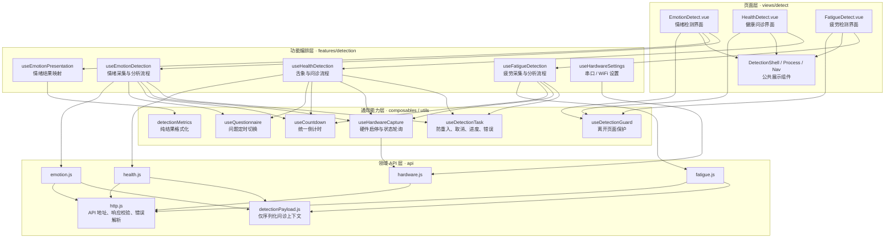
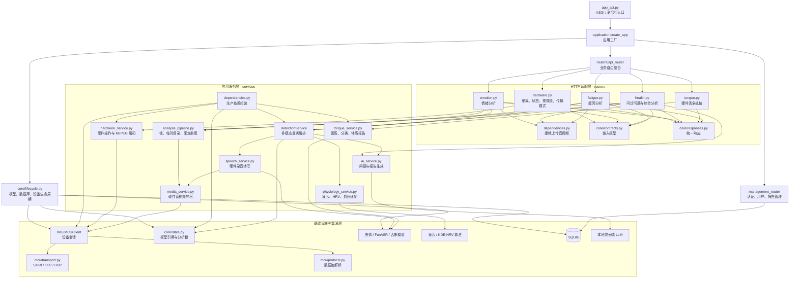
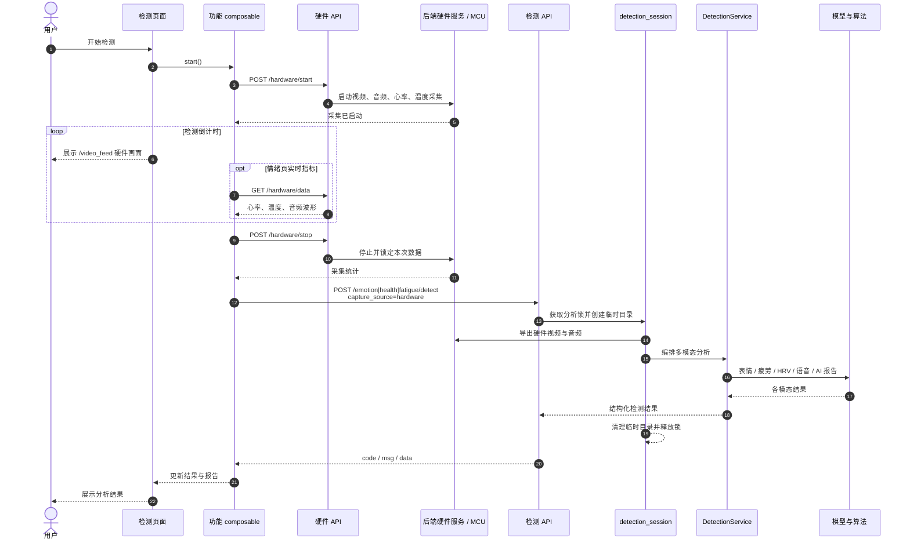

# 代码结构与解耦说明

## 项目分区

| 目录 | 职责 | 主要依赖 |
| --- | --- | --- |
| `app/src/views/detect` | 检测页面模板与用户交互入口 | 功能 composables、展示组件 |
| `app/src/features/detection` | 检测流程、硬件设置与结果展示映射 | 共享 composables、领域 API |
| `app/src/styles/detection` | 三个检测页面的 scoped 样式 | 由页面样式引用 |
| `app/src/api` | 后端请求与错误转换 | Axios |
| `app/src/composables` | 请求生命周期、倒计时、硬件采集、问答与离开守卫 | Vue、硬件 API |
| `Emotion-Detect-py/routers` | HTTP 参数、状态码、响应封装 | 会话适配层、服务依赖入口 |
| `Emotion-Detect-py/services` | 检测编排、媒体处理、推理适配、报告生成 | 注入的设备、模型、算法与外部服务 |
| `Emotion-Detect-py/mcu` | 设备会话、协议、传输和音频导出 | 串口、TCP/UDP、音视频库 |
| `Emotion-Detect-py/management` | 用户认证、报告持久化与统计 | SQLite、JWT |
| 各模型目录 | 表情、语音、疲劳、心率和舌象算法 | 模型框架、权重文件 |

检测链路按前端页面、功能流程、采集能力、领域 API、后端路由、业务服务和算法适配分层。管理端复用统一 HTTP 配置与错误解析，其数据库查询业务保持原有结构。

## 前端调用关系



`useDetectionTask` 处理防重入、请求取消和分析进度。各功能自行持有结果数据，迟到的响应不会恢复已离开的页面。`useHardwareCapture` 管理本页面启动的采集和串行轮询，页面离开时停止设备；启动响应迟到时补发停止请求。前端不申请摄像头或麦克风权限，不创建本地录制器。

`useQuestionnaire` 只管理问题及定时切换；语音由硬件录制，采集结束后在后端统一转写。`useEmotionPresentation` 和 `utils/detectionMetrics.js` 负责把后端结果映射为展示值，不发请求、不操作硬件。报告通过文本插值显示；缺失生理数据不伪装为正常值，心率图只使用实测历史数据。

管理端 `utils/request.js` 和检测端使用同一 HTTP 工厂与 `VITE_API_BASE_URL`。管理端配置 token、toast 和 401 跳转；检测 API 返回业务数据，由功能流程显示错误，不触发登录跳转。旧的 `api/detect.js` 已迁移为按领域划分的 API 文件；`api/report.js` 只保留管理端报告操作。

## 后端调用关系



图中的业务服务关系由组合入口注入；`DetectionService` 本身不导入 FastAPI、硬件单例、模型框架或 AI 客户端。

## 前后端联合检测链路



## 拆分后的职责

- **`app_api.py`**：保留 `python app_api.py` 与 `uvicorn app_api:app` 启动方式，以及原有端口清理逻辑。
- **`application.create_app`**：创建应用、挂载中间件、路由和静态资源。可替换 lifespan，测试时无需启动硬件或加载模型。
- **`core/lifecycle.py`**：分别加载表情、语音和舌象模型，初始化数据库，管理设备启停。可选模型的导入在各自异常边界内，一个模型失败不会阻断其他模型初始化。
- **`services/dependencies.py`**：将共享模型容器、设备实例和分析/报告函数组装成服务，是生产依赖的明确入口。
- **`services/detection_service.py`**：组织情绪、健康、疲劳分析，汇总各模态并调用报告生成；心率融合规则也集中在这里。
- **`services/analysis_pipeline.py`**：作为 HTTP 会话适配层，负责分析锁、停止采集、选择视频源、临时文件清理与 409/503/500 映射。
- **`services/media_service.py`**：后端硬件音视频导出；需要采集数据时由调用方显式传入设备。
- **`services/speech_service.py`**：选择会话音频、调用注入的语音模型、清洗识别文本。
- **`services/physiology_service.py`**：疲劳和心率算法适配，保留缺失数据与不可用状态的返回约定，算法在实际需要时导入。
- **`services/hardware_service.py`**：硬件启停、汇总、传输模式和 MJPEG 编码；HTTP 路由通过依赖入口获取实例。
- **`core/contracts.py`**：采集来源、录制参数、传输参数和问诊 JSON 形状校验。`core/responses.py` 统一检测成功响应。
- **`routers/tongue.py`**：硬件舌象抓拍的 HTTP 适配，和问诊接口分开。
- **`services/tongue_service.py`**：画质检查、调用注入的舌象模型、转换标签与生成体质报告；推理锁由调用方传入。
- **`tongue_diagnosis/errors.py`**：不依赖 PyTorch 的异常契约；原预测器模块继续导出相同异常类型。
- **`services/video_service.py`**：旧导入路径的兼容层，不再承载实现；新代码应直接引用对应服务。

## 保持的行为与修复

所有检测统一使用后端硬件设备。前端执行 `/hardware/start` → `/hardware/stop` → 对应的检测分析请求；三个页面均展示 `/video_feed` 的硬件摄像头画面。舌象通过 `/health/tongue/capture` 抓拍，不再提供图片上传检测入口。

检测请求不携带音视频文件。`capture_source` 只接受 `hardware`，省略时也使用硬件；原 `browser`、`auto` 值返回 422，上传 `audio` 或 `video` 返回 400。保留 `code/msg/data` 响应及 `/report/*`、`/serial/*` 别名。无硬件视频的疲劳检测返回 409。

浏览器摄像头、麦克风、MediaRecorder 和 Web Speech 识别实现均已移除。问题按计时切换，前端不生成逐题回答；健康报告接收后端 `voice_segments` 整段转写，不臆造转写与各问题的对应关系。视频心率算法的输入也来自后端硬件摄像头，硬件心率传感器存在数据时仍优先采用。

无效端口和录制时长返回 422；不支持的硬件模式保留 400；问诊 JSON 语法或容器类型错误返回 400。

锁检查改为发生在停止采集之前：被拒绝的重复请求不会停止正在录制的设备。临时目录创建失败时也会释放锁；正常返回、异常和请求取消均清理会话目录。

健康报告在舌象、问题、已有回答与生理数据之外，显式接收后端硬件录音转写；转写结果也随响应返回。

## 扩展与测试约定

1. 增加分析能力时，将推理实现放入对应服务或算法模块，通过 `dependencies.py` 注入编排服务；不要在路由里加载模型或拼接报告。
2. 调整串口/WiFi 协议时修改 `mcu`；业务服务只使用设备能力接口，不读取传输层内部状态。
3. 新增 HTTP 字段或错误状态由路由/会话适配层处理；业务异常不要直接依赖 `HTTPException`。
4. 前端页面不直接构建 FormData、发网络请求或创建计时器；流程放入 `features/detection`，可复用能力放入 `composables`。
5. 业务测试直接构造 `DetectionService` 并传入替身依赖；接口测试使用 `app.dependency_overrides[get_detection_service]` 或 `get_tongue_analyzer`，并替换 lifespan。

从仓库根目录运行回归测试：

```powershell
npm --prefix app test
npm --prefix app run build
python -m pytest Emotion-Detect-py/tests/test_detection_services.py Emotion-Detect-py/tests/test_mcu_protocol.py Emotion-Detect-py/tests/test_wifi_transport.py Emotion-Detect-py/tests/test_mix_firmware.py Emotion-Detect-py/tests/test_mcu_control.py -q
```

前端测试使用 Node 自带测试运行器，不引入额外测试框架。测试覆盖三类完整检测流程、请求契约、资源迟到/取消/清理、失败重试和指标映射；后端覆盖编排、仅硬件输入约束、接口兼容、异常清理、轻量应用导入及硬件协议。真实模型精度、ffmpeg 转码质量、摄像头/串口采集和本地大模型联调仍需相应运行环境验证。

## 现有边界

模型和硬件仍按原设计在进程内共享；应用工厂不代表每个应用或用户拥有独立设备。三类检测各自的锁也不提供跨功能的设备会话隔离。多用户并发采集需要另行设计会话标识、采集快照与设备占用策略。

前端取消请求可阻止迟到结果更新，但不会终止后端已经开始的同步模型推理。管理端数据库层和模型算法没有在此重构中重新设计。硬件层已依据 `esp32s3/mix/mix.ino` 对齐，模块职责、协议和部署限制见 [硬件协议说明](hardware-protocol.md)。
